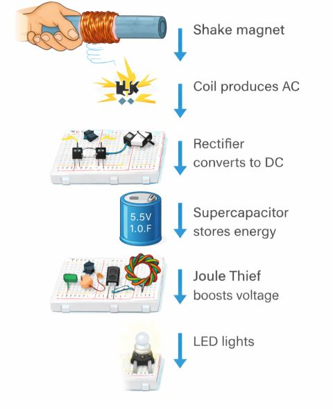

# ⚡ Faraday Flashlight — A Battery-Free LED Light Powered by a Shake

> *No batteries. No charging cable. Just physics.*

A shake-powered LED flashlight built entirely on **Faraday's Law of Electromagnetic Induction**, paired with a **Joule Thief voltage booster** to keep the LED bright even as stored energy fades. This was my semester final project, combining electromagnetism, circuit design, and hands-on prototyping into a single working device.


<p align="center">


https://github.com/user-attachments/assets/c5e79680-e6a6-4369-a7a2-38d7127fda21


</p>

<p align="center">
  
</p>

---

## 🔦 What It Does

Shake the flashlight → a neodymium magnet slides through a coil of copper wire → the changing magnetic flux induces an alternating current → that AC is rectified to DC and stored in a supercapacitor → a Joule Thief circuit boosts the stored voltage so the LED lights up brightly, even after the capacitor has partially discharged.

No chemical battery is involved anywhere in the design.

---

## ⚙️ How It Works

| Stage | What Happens | Principle |
|---|---|---|
| **1. Shake** | A neodymium magnet moves back and forth through a copper coil | Mechanical → magnetic energy |
| **2. Induction** | The coil generates an alternating current (AC) | Faraday's Law of EM Induction |
| **3. Rectification** | A 4-diode bridge rectifier converts AC → DC | Full-wave rectification |
| **4. Storage** | The DC charges a supercapacitor | Energy storage (no chemical battery) |
| **5. Boosting** | A Joule Thief circuit steps up low voltage | Self-oscillating flyback converter |
| **6. Output** | The LED glows — even on a nearly-drained capacitor | Voltage boost sustains brightness |

---

## 🧰 Components Used

**Mechanical / Magnetic**
- Neodymium magnets (15 × 2 mm)
- PVC / transparent tube (~20 mm diameter)
- Enameled copper magnet wire

**Power Electronics**
- Bridge rectifier (4 diodes)
- Supercapacitor — 5.5 V, 1.0 F

**Joule Thief Circuit**
- NPN transistor (BC547 or 2N2222)
- Bifilar-wound toroid coil
- 1 kΩ resistor
- LED
- Breadboard, jumper wires
- Push button / switch

---

## 🧠 Why These Design Choices

**Supercapacitor over a battery.** A supercap charges almost instantly from a short burst of shaking, tolerates thousands of charge/discharge cycles without degrading, and needs no chemistry-based maintenance — a much better fit for an "shake it, use it now" device than a rechargeable cell.

**The Joule Thief is what makes this actually work.** Hand-shaking alone rarely generates enough voltage to forward-bias an LED directly, and that voltage keeps dropping as the capacitor discharges. The Joule Thief's self-oscillating transformer circuit steps up even a very low input voltage, keeping the LED lit well past the point where it would otherwise go dark.

**Bifilar winding on the toroid.** Winding both coils together (rather than separately) keeps them tightly magnetically coupled, which is essential for reliable oscillation in the Joule Thief topology.

---

## 🚧 Challenges & What I Learned

- Getting consistent induction required tuning the magnet's fit and travel distance inside the coil tube — too loose and flux linkage dropped, too tight and the magnet couldn't move freely.
- Diode forward-voltage drop in the rectifier stage noticeably ate into the already-small induced voltage, making the case for the boost stage even stronger.
- Small changes in toroid winding count changed the Joule Thief's oscillation behavior — this took several iterations of trial and error to dial in.

---

## 🔭 Future Improvements

- [ ] Increase supercapacitor capacity or add a second cap in parallel for longer light duration
- [ ] Experiment with coil turn count / wire gauge to improve induction efficiency
- [ ] Add a rectifier with lower forward-voltage-drop (e.g., Schottky diodes) to reduce losses
- [ ] Design a 3D-printed enclosure for a more compact, durable housing
- [ ] Add a small onboard voltage indicator (e.g., a second low-power LED) to show charge state

---

## 📸 Gallery & Demo

- 🎬 **[Full demo video](faraday-flashlight-demo.mp4)** — the complete build being shaken and lighting up the LED
- 🖼️ Preview GIF shown at the top of this README

```
demo-preview.gif                 (short looping preview)
faraday-flashlight-demo.mp4      (full demo)
process-flow.png                 (step-by-step diagram)
```

*Feel free to add more build photos (breadboard close-ups, final assembly) to the repo — real photos of the physical build add a lot of credibility alongside the video.*

---

## 📚 References

- Faraday's Law of Electromagnetic Induction
- Joule Thief circuit — minimal self-oscillating boost converter topology

---

## 🏷️ Topics

`physics` `electronics` `hardware` `diy` `faraday-law` `joule-thief` `energy-harvesting` `stem-project`

---

## 📄 License

This project is shared under the [MIT License](LICENSE) — feel free to build on it, remix it, or use it for your own coursework with attribution.
